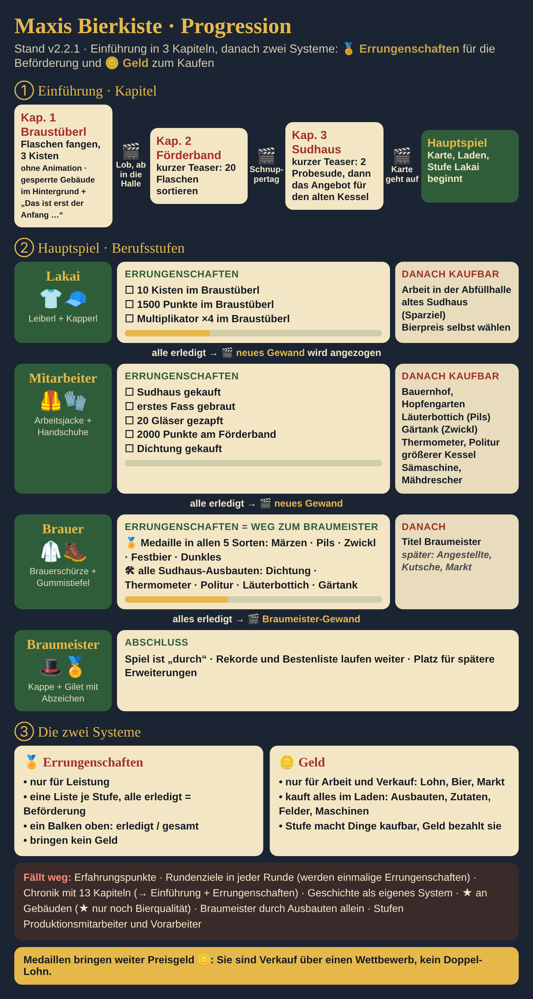

# Progression · Ausgangsbasis (Stand v2.2.1)

Diese Übersicht ist die verbindliche Grundlage für Maxis Bierkiste. Neue Funktionen werden hier eingeordnet, bevor sie gebaut werden.

## Einführung: 3 Kapitel

| Kapitel | Spiel | Ende |
|---|---|---|
| 1 Braustüberl | Flaschen fangen, 3 Kisten. Ohne Animation; auf der Karte ist alles außer dem Braustüberl gesperrt („Das ist erst der Anfang …“) | 🎬 Lob vom Braumeister, ab in die Halle |
| 2 Förderband | Teaser: 20 Flaschen sortieren | 🎬 Einladung zum Schnuppertag |
| 3 Sudhaus | Teaser: 2 Probesude | 🎬 Angebot für den alten Kessel, Karte offen |

Alle Kapitel außer dem ersten beginnen mit einer Animation.

## Hauptspiel: zwei Systeme

- **🏅 Errungenschaften** – nur für Leistung, bringen kein Geld. Jede Stufe hat eine Liste; sind alle erledigt, wird Maxi befördert.
- **🪙 Geld** – nur für Arbeit und Verkauf (Lohn, Bier, Markt, Preisgeld beim Bierwettbewerb). Kauft alles im Laden.
- Eine Stufe macht Dinge **kaufbar**, bezahlt wird mit Geld.
- Oben auf der Karte gibt es **einen Balken**: erledigte Errungenschaften der Stufe.
- **★ bedeutet nur Bierqualität.**

## Berufsstufen

| Stufe | Gewand (Animation bei der Beförderung) | Errungenschaften für die nächste Stufe | danach kaufbar |
|---|---|---|---|
| Brauereilakai | Leiberl + Kapperl | 10 Kisten im Braustüberl · 1500 Punkte im Braustüberl · Multiplikator ×4 im Braustüberl | Abfüllhalle, altes Sudhaus, eigener Bierpreis |
| Mitarbeiter | Arbeitsjacke + Handschuhe | Sudhaus gekauft · erstes Fass · 20 Gläser · 2000 Punkte am Förderband · Dichtung | Bauernhof, Hopfengarten, Läuterbottich, Gärtank, Thermometer, Politur, größerer Kessel, Sämaschine, Mähdrescher |
| Brauer | Brauerschürze + Gummistiefel | Medaille in allen 5 Sorten + alle 5 Sudhaus-Ausbauten | Titel Braumeister |
| Braumeister | Braumeisterkappe + Gilet mit Abzeichen | – | später: Angestellte, Kutsche, Markt |

## Entfallen mit v2.0.0

Erfahrungspunkte · Rundenziele in jeder Runde (einzelne Punkteziele sind jetzt Errungenschaften) · Chronik mit 13 Kapiteln · Geschichte als eigenes System · Sterne an Gebäuden · Braumeister allein durch Ausbauten · Stufen Produktionsmitarbeiter und Vorarbeiter

## Offen für später

Minispiele (Prototypen im Debug-Menü der Testversion), Angestellte mit Lohn, mehrere Kessel, Bauernhof Stufe 2 (Hopfen, Stall).
